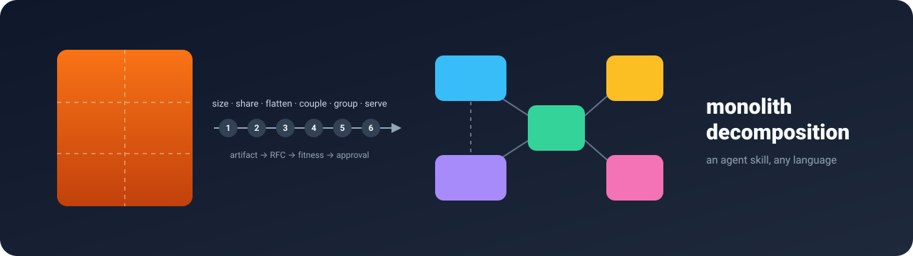
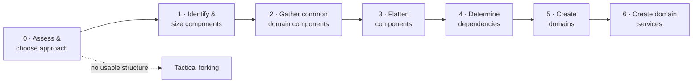
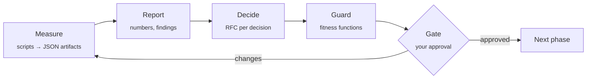

<p align="center">
  
</p>

<h1 align="center">Monolith Decomposition Skill</h1>

<p align="center">
  <b>Break a monolith into microservices one measured, reviewed and protected step at a time.</b><br>
  An agent skill for Claude Code (and other coding agents) that works with any programming language.
</p>

<p align="center">
  <a href="LICENSE"></a>
  <a href="https://github.com/dewyll/monolith-decomposition-skill/actions/workflows/ci.yml"></a>
  
  
  <a href="CONTRIBUTING.md"></a>
</p>

<p align="center">
  <a href="plugins/monolith-decomposition/skills/decompose/adapters/jvm.md"></a>
  <a href="plugins/monolith-decomposition/skills/decompose/adapters/jvm.md"></a>
  <a href="plugins/monolith-decomposition/skills/decompose/adapters/dotnet.md"></a>
  <a href="plugins/monolith-decomposition/skills/decompose/adapters/typescript.md"></a>
  <a href="plugins/monolith-decomposition/skills/decompose/adapters/typescript.md"></a>
  <a href="plugins/monolith-decomposition/skills/decompose/adapters/python.md"></a>
  <a href="plugins/monolith-decomposition/skills/decompose/adapters/go.md"></a>
  <a href="plugins/monolith-decomposition/skills/decompose/adapters/php.md"></a>
  <a href="plugins/monolith-decomposition/skills/decompose/adapters/ruby.md"></a>
  <a href="plugins/monolith-decomposition/skills/decompose/adapters/other.md"></a>
  <a href="plugins/monolith-decomposition/skills/decompose/adapters/other.md"></a>
  <a href="plugins/monolith-decomposition/skills/decompose/adapters/other.md"></a>
</p>

---

Most monolith-to-microservices migrations go wrong in the same place: the
service boundaries are guessed in a meeting, and nobody can say later why
they were drawn there. This skill turns the migration into a sequence of
small, evidence-based steps. At every step your agent **measures** the
codebase with scripts, **proposes** decisions backed by those numbers,
**records** them as architecture RFCs, **guards** them with fitness
functions, and **stops for your approval** before moving on.

The workflow follows the *component-based decomposition* patterns from
**Software Architecture: The Hard Parts** (Neal Ford, Mark Richards, Pramod
Sadalage and Zhamak Dehghani), with *tactical forking* as the alternative
for codebases with no usable structure. The book's spirit runs through the
whole process:

> Strive for "the least worst combination of trade-offs."
> — *Software Architecture: The Hard Parts*

## Contents

- [How it works](#how-it-works)
- [What each phase produces](#what-each-phase-produces)
- [Quick start](#quick-start)
- [Supported languages](#supported-languages)
- [What ends up in your repository](#what-ends-up-in-your-repository)
- [Try it on the example](#try-it-on-the-example)
- [FAQ](#faq)
- [Credits and further reading](#credits-and-further-reading)

## How it works



Every phase runs the same loop, much like spec-driven development:



Three rules keep it honest:

1. **Numbers come from scripts, judgement comes from people.** Sizes,
   coupling and cycles are computed, never estimated by the model.
2. **Every phase ends at a gate.** Domain boundaries are business
   decisions, so the agent stops and asks.
3. **Every decision is an RFC, and every RFC is protected by a fitness
   function** that can run in CI long after the migration starts.

## What each phase produces

| Phase | You get | Typical RFC | Fitness function |
|---|---|---|---|
| **0. Assess** | drivers, constraints, a structural probe | Component-based or tactical forking? | — |
| **1. Identify & size** | component inventory: size, % of codebase, z-score, outliers | Inventory and size thresholds | no component above *X*%, outliers justified |
| **2. Common domain** | shared-concern candidates, duplicated capabilities, fan-in | What gets consolidated, and where | duplicates cannot come back |
| **3. Flatten** | orphaned code in parent namespaces and where it goes | Flattening plan | no code in flattened parents |
| **4. Dependencies** | Ca/Ce/instability, cycles with their cheapest cut, matrix, Mermaid graph, co-change from git history, shared tables | Coupling assessment, how to break each cycle | no new cycles or edges beyond the baseline, coupling cap |
| **5. Domains** | clustering suggestions (Louvain), domain map, cross-domain edges, cohesion per domain | Domain map, contested boundaries | forbidden dependencies between domains |
| **6. Services** | service map, declared interfaces, extraction order | One per service, extraction order, shared-code reuse | undeclared cross-service calls fail CI |

## Quick start

### Install as a Claude Code plugin

```bash
claude plugin marketplace add dewyll/monolith-decomposition-skill
claude plugin install monolith-decomposition@dewyll-skills
```

(Inside a session: `/plugin marketplace add dewyll/monolith-decomposition-skill`.)

### Or copy the skill folder

```bash
git clone https://github.com/dewyll/monolith-decomposition-skill
cp -r monolith-decomposition-skill/plugins/monolith-decomposition/skills/decompose ~/.claude/skills/
# or into a single project: <project>/.claude/skills/decompose
```

Other agents that understand `SKILL.md` folders can load the same
directory. For any other agent, point it at
[`SKILL.md`](plugins/monolith-decomposition/skills/decompose/SKILL.md) as
its instructions; everything else is plain Markdown, JSON and Python.

### Use it

Open your monolith's repository and ask for it in plain words:

```text
Help me break this monolith into services. Start with the assessment.
```

```text
Resume the decomposition and show me where we are.
```

```text
Run phase 4 and tell me which cycles we should break first.
```

The plugin also exposes it as `/monolith-decomposition:decompose`
(`/decompose` when copied as a standalone skill).

**Requirements:** Python 3.9+ (standard library only). Optional:
[`scc`](https://github.com/boyter/scc) for faster, more precise size metrics,
and your ecosystem's dependency tools for higher-confidence graphs.

## Supported languages

The workflow and artifacts are language-neutral. Each ecosystem has an
adapter that explains what a "component" is there, how to extract
dependencies natively, and which fitness-function library to use.

| Ecosystem | Built-in import scanner | Native extractor | Fitness functions |
|---|:-:|---|---|
| Java · Kotlin · Scala | ✅ | `jdeps` | ArchUnit, Spring Modulith, Konsist |
| C# · F# | ✅ | ArchUnitNET | NetArchTest, ArchUnitNET |
| TypeScript · JavaScript | ✅ | dependency-cruiser, madge | dependency-cruiser, eslint-plugin-boundaries, Nx, ArchUnitTS |
| Python | ✅ | grimp | import-linter, Tach, pytest-archon |
| Go | ✅ | `go list` | the compiler, `internal/`, go-arch-lint, depguard |
| PHP | ✅ | — | Deptrac, PHPat, PHPArkitect |
| Ruby · Rails | ✅ (require only) | Packwerk | Packwerk |
| Rust · Elixir · C/C++ · Swift | ✅ | cargo-modules, `mix xref`, CMake | workspace crates, Boundary, build targets |
| Anything else | via `convert_edges.py` | any tool that prints `from → to` | generic `check_fitness.py` in CI |

Adapters live in [`skills/decompose/adapters/`](plugins/monolith-decomposition/skills/decompose/adapters/).
Tool health changes, so the skill tells the agent to check that a library
is still maintained before recommending it.

## What ends up in your repository

```text
decomposition/
├── config.json            mapping, thresholds, fitness rules
├── state.json             which phase you are in, who approved what
├── 00-assessment/         drivers, constraints, structural probe
├── 01-sizing/             components.json + readable report
├── 02-common-domain/      candidates and decisions
├── 03-flattening/         plan and re-measured inventory
├── 04-dependencies/       edges, metrics, matrix, Mermaid graph
├── 05-domains/            domain map, domain coupling, cohesion
├── 06-services/           service map and interfaces
├── fitness/               results of every check run
└── rfcs/                  0001-decomposition-approach.md, … index.md
```

Commit it. The RFC log becomes the architecture history of the migration,
and the same scripts run in CI as a guard. `run_guard.py` re-measures the
code and checks it against the decisions and the
[baseline](plugins/monolith-decomposition/skills/decompose/references/fitness-functions.md#the-baseline-a-ratchet-not-a-wall):
today's cycles and edges are frozen, and the build fails only on what gets
worse.

```bash
python3 $SKILL/scripts/run_guard.py --workspace decomposition
```

> "Everything in software architecture is a trade-off."
> — *Fundamentals of Software Architecture*, Mark Richards and Neal Ford

That is why every RFC has an explicit trade-offs section.

## Try it on the example

[`examples/tiny-monolith`](examples/tiny-monolith) is a deliberately messy
Python shop with an oversized component, orphaned code, a duplicated
notification module and an `orders` ↔ `inventory` cycle. Its committed
[`decomposition/`](examples/tiny-monolith/decomposition) folder is a complete
run, **phases 0 to 6 approved**: eight [RFCs](examples/tiny-monolith/decomposition/rfcs/index.md),
a domain map, a service map with extraction order, and a green guard.

```bash
SKILL=plugins/monolith-decomposition/skills/decompose
python3 $SKILL/scripts/init_workspace.py examples/tiny-monolith --dir scratch
python3 $SKILL/scripts/size_components.py      --workspace examples/tiny-monolith/scratch
python3 $SKILL/scripts/extract_dependencies.py --workspace examples/tiny-monolith/scratch
python3 $SKILL/scripts/analyze_dependencies.py --workspace examples/tiny-monolith/scratch
python3 $SKILL/scripts/suggest_domains.py      --workspace examples/tiny-monolith/scratch
python3 $SKILL/scripts/check_fitness.py        --workspace examples/tiny-monolith/scratch --phase all
```

<details>
<summary><b>Script reference</b></summary>

| Script | Purpose |
|---|---|
| `init_workspace.py` | Detect languages and source roots, create the workspace |
| `size_components.py` | Map files to components, measure size, flag outliers and orphaned code |
| `find_common_candidates.py` | Shared-concern, duplicate and fan-in signals for Phase 2 |
| `extract_dependencies.py` | Import scanner for many languages (`ast` for Python, comment-aware regex elsewhere; low-confidence fallback) |
| `convert_edges.py` | Turn any tool's `from<TAB>to` output into neutral edges |
| `change_coupling.py` | Churn and co-change from git history; flags pairs with no static dependency |
| `find_data_coupling.py` | Tables per component from ORM mappings and SQL strings; `database` edges |
| `analyze_dependencies.py` | Ca, Ce, instability, cycles with cut candidates, matrix, Mermaid, domain cohesion; merges extra edge files |
| `suggest_domains.py` | Louvain clustering over imports + co-change as a starting point for domains |
| `check_fitness.py` | Generic fitness functions per phase, `guard` mode and baseline ratchet for CI |
| `run_guard.py` | One command for CI: re-measure, analyse, check the guard set |
| `new_rfc.py` | Numbered RFCs from the template, statuses, superseding, index |
| `state.py` | Phase state machine that enforces the gates (accepted RFCs, passing fitness) |

All scripts are Python 3.9+ with no third-party dependencies.
</details>

## FAQ

**Will the agent rewrite my code?**
Not on its own. Phases 1, 3 and 6 can involve refactoring; the skill makes
the agent propose a plan and only move code when you ask.

**How accurate are the numbers?**
Sizes are exact for the chosen metric. Dependencies from the built-in
scanner are a lower bound (static imports only) and are labelled
*low confidence*. Native extractors, change coupling from git history,
the shared-table scan and the hidden-coupling checklist in Phase 4
(dependency injection, events, reflection) close the gap.

**What about the database?**
Code decomposition comes first. Shared tables are found by
`find_data_coupling.py` and recorded as coupling in Phase 4 and as open data decisions in Phase 6; splitting the data itself is
the next step of the migration and is out of scope for this skill.

**We already use ADRs.**
Point `workspace.rfc_dir` at your ADR folder; the template has the same
spirit (context, options, decision, consequences) plus a fitness-function section.

**Does it need network access?**
No. The scripts run offline. The agent may search the web to confirm a
library is still maintained before recommending it.

## Credits and further reading

This project is an independent interpretation and is not affiliated with
the authors or O'Reilly Media. The process is described in our own words;
read the books for the full reasoning.

- Neal Ford, Mark Richards, Pramod Sadalage, Zhamak Dehghani. *Software
  Architecture: The Hard Parts.* O'Reilly, 2021. Component-based
  decomposition patterns and tactical forking.
- Mark Richards, Neal Ford. *Fundamentals of Software Architecture.*
  O'Reilly, 2020.
- Neal Ford, Rebecca Parsons, Patrick Kua, Pramod Sadalage. *Building
  Evolutionary Architectures.* O'Reilly, 2nd ed. 2023. Fitness functions.
- Robert C. Martin. Package coupling metrics (afferent/efferent coupling,
  instability).

## Contributing

New adapters, better extractors and real-world feedback are very welcome.
See [CONTRIBUTING.md](CONTRIBUTING.md).

## License

[MIT](LICENSE) © Denys Wylliam

<sub>Related topics: monolith to microservices, microservices migration,
modular monolith, service boundaries, domain-driven design (DDD), bounded
contexts, architecture decision records (ADR), architectural fitness
functions, coupling and cohesion analysis, dependency graph, software
architecture, legacy modernization, Claude Code skill, agent skills, AI
coding assistant.</sub>
